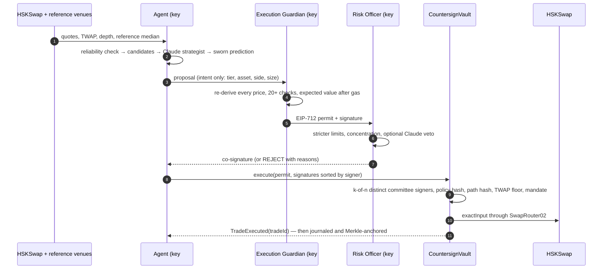

<div align="center">

# Countersign

### The AI trader that can't trade alone.

**An autonomous AI trading agent for HSKSwap whose every trade needs a second and third signature, from an independent committee, checked by the vault on HSK Chain.**

[](https://hsk.blockscout.com/address/0x5c13500A4aD4277a13C7d774a78Cfd267A202030)
[](#verify-it-yourself-in-3-minutes)
[](#verify-it-yourself-in-3-minutes)
[](#tested)
[](#deployments)

**[Live dashboard](https://vendhan1512.github.io/Al-Trading-Automation/)** · **[Try to break it](https://vendhan1512.github.io/Al-Trading-Automation/?run=1#break)** · **[The mainnet trade](https://hsk.blockscout.com/tx/0x6e02064a32009d8636bd60c002d9c7ee0fe4b4b88235cda6b7b8c8b769d74584)** · **[Deployments](docs/DEPLOYMENTS.md)**

*HSK Chain Horizon Hackathon (Seoul) · Track 1: AI Agent Trading*

</div>

---

## The problem nobody else solves

Putting trading rules in a vault is the right first step: caps, slippage floors, stop-losses the model cannot argue with. But in a guardrailed vault **one key still decides every trade.** If that key leaks, or the model is prompt-injected, or the strategy has a bug, the attacker gets the agent's whole allowance: every trade the rules permit, as fast as the cooldown allows, into whatever the market is doing.

Banks solved this decades ago with the **two-person rule**: the trader proposes, risk countersigns, and the books refuse anything unsigned.

**Countersign puts the two-person rule on-chain.**

```
   AI agent ──proposes──► Execution Guardian ──signs──► Risk Officer ──co-signs or vetoes──► CountersignVault ──► HSKSwap
  (key #1, can           (key #2, re-prices           (key #3, stricter limits,          (checks k-of-n EIP-712
   only submit)           at the live quote)            optional Claude veto)               signatures + the mandate)

                            Owner (hardware wallet): sets the mandate, picks the committee, pauses, withdraws.
```

The agent's key **cannot sign its own trades.** The vault accepts a trade only with *k* of *n* EIP-712 permits from distinct committee members. Each permit binds the exact route, size, output floor, edge claim, expected value, prediction hash and policy hash. Change the rules or the committee, and every outstanding permit dies.

## Proof on HSK Chain mainnet

Real money, a real vault, real HSKSwap pools: all verifiable on [Blockscout](https://hsk.blockscout.com/address/0x5c13500A4aD4277a13C7d774a78Cfd267A202030).

| | What happened | Transaction |
|---|---|---|
| 🏦 | The owner creates a **2-of-2 committee vault** from their own wallet | [`0x50e4f0c4…0100`](https://hsk.blockscout.com/tx/0x50e4f0c427e15efe34ffab430705d186f50b5301354dfebecec97b846d560100) |
| 💧 | The owner deposits 75 HSK as WHSK; the vault books its cost at the 30-minute TWAP | [`0xd186b87c…f864`](https://hsk.blockscout.com/tx/0xd186b87c6e84e10b88b09662585141c917075c64702da84cb70bcf5195e8f864) |
| 🌳 | **475 decisions** (every refusal included) committed as one Merkle root | [`0x9ad3ce93…dea7`](https://hsk.blockscout.com/tx/0x9ad3ce936fadc559d92351ff835e35f74e8696b835ba1b72ead827771f21dea7) |
| 📈 | The keeper records the NAV high-water mark for the drawdown breaker | [`0x896f6901…879e`](https://hsk.blockscout.com/tx/0x896f69019e99cb4f0fa13a7fe7b846f0ad52adcf1d16a172f13b1902ba43879e) |
| ✍️ | **First countersigned trade.** The owner says *"rebalance 50% to USDT"*; the agent proposes it; the **Guardian and the Risk Officer both sign**; the vault executes 38 WHSK → **3.0188 USDT** (committee floor 3.0112) | [`0x6e02064a…4584`](https://hsk.blockscout.com/tx/0x6e02064a32009d8636bd60c002d9c7ee0fe4b4b88235cda6b7b8c8b769d74584) |
| 🛡️ | **15 attacks** fired at the live vault (stolen agent key, forged committee, route swap, drain, takeover…): **15/15 blocked** by the contract's own reverts | [run them yourself](https://vendhan1512.github.io/Al-Trading-Automation/?run=1#break) |

## Verify it yourself in 3 minutes

**1. Try to break it. No wallet, no gas.** Open **[the Break-It Arena](https://vendhan1512.github.io/Al-Trading-Automation/?run=1#break)**. Your browser fires 15 real attacks at the mainnet vault with `eth_call` and shows the vault's revert for each:

| Attack | Vault says |
|---|---|
| Agent signs its own permit (stolen agent key) | `InvalidPermit` |
| Agent submits with no countersignature | `NotEnoughSignatures(0, 2)` |
| Attacker forges a committee | `InvalidPermit` |
| Outsider or Guardian submits a permit | `NotAgent` |
| Permit signed under the old policy | `PolicyMismatch` |
| Expired permit | `PermitExpired` |
| Route swapped after signing | `PathMismatch` |
| Agent withdraws, rewrites the mandate, replaces the committee or takes ownership | `NotOwner` |
| Agent loosens a limit 10× | `NotTighter` |
| Fake stop-loss on a healthy position | refused |

**2. Verify the mainnet trade from raw chain data.**
```bash
cd agent && pnpm verify trade 0x6e02064a32009d8636bd60c002d9c7ee0fe4b4b88235cda6b7b8c8b769d74584
```
```
PASS  transaction succeeded              block 30722641
PASS  target is a Countersign factory vault
PASS  call is vault.execute
PASS  sender was the vault's agent
PASS  permit policy = vault policy (block-1)
PASS  path hash matches the route
PASS  every signer was on the committee  0x2697…6E29, 0xE278…ac5D
PASS  signers are distinct               2 distinct
PASS  threshold met (2-of-2)             2 signatures
PASS  the agent did not sign its own permit
PASS  TradeExecuted emitted by the vault
PASS  event tradeId = permit tradeId
PASS  fill >= the committee's minOut     3018754 >= 3011207
PASS  expected value committed on-chain
VERIFIED — 14/14 checks passed
```
It recovers both committee signers from the EIP-712 permit inside the transaction. Nothing is taken on trust from our database.

**3. Verify any decision, refusals included.** `VAULT=0x5c13…2030 pnpm verify decision 474` re-hashes the decision, finds the anchored Merkle root on-chain and checks the proof: **VERIFIED 3/3.**

## Why it's different

| If this happens… | A guardrailed vault | **Countersign** |
|---|---|---|
| The agent's key leaks | The attacker trades the full allowance within the caps | **Cannot trade at all.** The agent key alone fails `NotEnoughSignatures` |
| The model is prompt-injected | Bad trades go through as long as they fit the caps | Two independent processes re-price it at the live quote; the Risk Officer runs **stricter limits** and can veto |
| The agent and its server go offline mid-crash | The stop-loss waits for a keeper or for the agent | `stopOut()` is **permissionless**: anyone can fire it, on the 30-min TWAP, with a TWAP-anchored floor |
| A whale wicks the pool for one block | The spot-priced stop fires into the wick | A one-block 1.5M WHSK dump does **not** trigger the TWAP stop (mainnet-fork test); the same crash held 30 minutes does |
| A trade can't pay its own gas | It goes through and bleeds | Entries must carry a **committee-signed positive expected value after both fees, impact, exit and gas** |
| The operator edits the history afterwards | Off-chain logs can be rewritten | Every decision is hashed and **Merkle-anchored**; any one re-verifies against the chain |
| The owner wants it safer *now* | A new config, a redeploy, or trust | Say it in Mission Control; the agent applies **stricter-only** changes via `tighten()`; looser ones need the owner's wallet |

## What the track asks for, and where Countersign does it

| Requirement | Countersign |
|---|---|
| **Monitor markets & on-chain data** | Every 30 s: HSKSwap spot, 30-min TWAP, depth and price impact at size, pool flow, plus a reference median from HashKey Global, Gate, MEXC, Coinbase and the APRO oracle. A Data Reliability Engine rejects stale, crossed, wide or outlier books, and returns **WAIT** when no reliable reference exists |
| **Identify signals & execute autonomously** | Three tiers: **A** cycle arbitrage, **B** spread reversion (HSKSwap vs the exchange median), **C** mean reversion with a **sworn prediction** (target, invalidation, probability; committed on-chain, graded later with a Brier score). The **Claude** strategist may take, shrink or skip a candidate, never enlarge it |
| **Arbitrage & spreads in real time** | An Arbitrage Radar prices every HSK venue (HSKSwap, Hyperindex, WoofSwap, WETH triangles) at executable size and after gas. Live finding: 150–157 bps gaps exist, but the side pools hold $72–$159, so every route loses before gas. **The agent says so instead of pretending** |
| **Strict risk controls & stop-loss** | Enforced by the vault: per-trade cap, daily volume, daily loss stop (exits still allowed), exposure per asset, cooldown, TWAP slippage floor, minimum edge, permissionless TWAP stop-loss and take-profit, NAV drawdown breaker, 1 h re-entry lockout, mandate expiry, pause, revoke. **Plus the 2-of-*n* committee in front of all of it** |
| **Conversational interface** | **Mission Control**: "How are we doing?", "Why aren't you trading?", *"What if I buy 5 USDT of BTC now?"* (runs the real Guardian in dry-run), *"Low risk, only ETH and BTC, stop loss 2%"* (a diff card the owner signs), and **Rebalance to USDT** (owner request → committee-signed exit) |
| **Built on HSK Chain + HSKSwap** | Mainnet vault, factory and implementation verified (Sourcify exact match and Blockscout); every swap goes through HSKSwap SwapRouter02; every TWAP comes from HSKSwap's own pools |

## Mission Control and the dashboard

The **[dashboard](https://vendhan1512.github.io/Al-Trading-Automation/)** is built to be played with, not just read:

- **Vault Pour.** Your vault drawn as a glass jar filled with its live holdings. Drag through the scenes: deposit, a sealed trade, a stop-loss that converts the position, the breaker slamming the lid.
- **Countersign Stage.** An envelope travels from the agent to the Guardian to the Risk Officer to the vault, collecting wax seals, or gets knocked off with the vault's real revert.
- **Break-It Arena.** The 15 live attacks above, as projectiles hitting the vault.
- **Decision heartbeat.** Every tick the agent journals, with WAIT streaks grouped and every Guardian check one click away.
- **Markets and arbitrage radar.** Live gaps against the exchange median, with hover history.
- **Mission Control.** Chat with the agent; sign in with your wallet (a signature only, no gas) to apply changes or request a rebalance.

Run locally, it talks to the live agent. On GitHub Pages it shows a published snapshot of the same data.

## How a trade happens



## Tested

**217 tests**, all passing:

- **101 contract tests** (Foundry): unit tests, v2 committee tests, invariants with a liveness check, and **8 against the real HSKSwap pools on a mainnet fork** (TWAP stop vs one-block wick, TWAP floor vs a worthless `minOut`, breaker, re-entry lockout).
- **116 agent tests** (Vitest): reliability engine, candidates, Guardian and Risk Officer, transaction-manager recovery, copilot, owner sessions and requests, Merkle evidence.

Every scenario from the design document has a named test:

| Scenario | Behaviour | Proof |
|---|---|---|
| False opportunity (stale quote) | Stale, wide, crossed or outlier sources excluded; no reliable reference → WAIT | `engine.test.ts` "Scenario 1" |
| Low liquidity | Impact above the limit → REJECT; the Risk Officer is stricter (30 vs 50 bps) | `guardian.test.ts` "Scenario 2", `v2.test.ts` |
| Slippage moves before execution | TWAP floor + router minimum → revert, never a silent bad fill | `test_Revert_RouterMinOutWhenMarketMoves`, fork `TwapFloorRejectsWorthlessMinOut` |
| Duplicate submission | Blocked locally and on-chain (`usedTradeIds`) | `phase5.test.ts` "Scenario 4", `test_Attack_ReplayTradeId` |
| AI exceeds its mandate | Guardian REJECT; vault `TradeTooLarge` | `guardian.test.ts` "Scenario 5", `testFuzz_CapAlwaysEnforced` |
| Daily loss limit | Entries stop, exits continue, UTC reset | `test_DailyLoss_BlocksEntries_AllowsExits_ResetsNextDay` |
| Strategy deteriorates | Circuit breaker pauses or tightens; NAV drawdown breaker on-chain | `phase5.test.ts` "Scenario 7", `test_Breaker_*` |
| Owner revokes the agent | `setAgent(0)`; permissionless stops keep working | `test_StopLoss_WorksWithAgentRevokedAndVaultPaused` |
| RPC failure | Market REJECT, no state changes, reconcile before resuming | `engine.test.ts` "Scenario 9" |
| Prediction is wrong | Graded INVALIDATED (write-once); exit; Brier tracked apart from P&L | `phase5.test.ts` grading tests |

## What the backtest taught us

30 days of real HSKSwap swaps (2,750) and exchange candles, replayed through the live rules, **nothing tuned**:

| Policy | WHSK | WETH | WBTC | Total (USDT) |
|---|---|---|---|---|
| Rules alone (no gate) | −1.82 | −2.81 | −2.38 | **−7.00** |
| First Guardian (valued entries at full gap convergence) | −0.80 | −1.80 | −1.72 | **−4.32** |
| **Fixed Guardian (values entries at the strategy's own half-gap exit)** | **−0.07** | **+0.08** | **−0.64** | **−0.63** |

The replay found a real flaw: the first Guardian assumed the whole gap would close, while the strategy only targets half of it, so it approved trades whose own target couldn't pay two pool fees plus gas. After the fix the committee refuses about 99% of candidates and **cuts losses by 91%**. That is not a profitable edge, and we don't claim one. It shows the committee refuses trades that can't pay for themselves. Full write-up: [research/backtest.md](research/backtest.md). Venue measurements: [research/pools.md](research/pools.md).

## Deployments

**HSK Chain mainnet (177)**

| Contract | Address | Verification |
|---|---|---|
| **Owner vault, 2-of-2 committee (live)** | [`0x5c13500A4aD4277a13C7d774a78Cfd267A202030`](https://hsk.blockscout.com/address/0x5c13500A4aD4277a13C7d774a78Cfd267A202030) | factory clone |
| CountersignVault v2 implementation | [`0x0728B021D518a916edC1dc7689d6fBD23d601098`](https://hsk.blockscout.com/address/0x0728B021D518a916edC1dc7689d6fBD23d601098) | Sourcify exact + Blockscout full |
| VaultFactory v2 | [`0x564ae60993717fF696c6E261F3CD7d4Ee9c56af4`](https://hsk.blockscout.com/address/0x564ae60993717fF696c6E261F3CD7d4Ee9c56af4) | Sourcify exact + Blockscout full |
| HSKSwap SwapRouter02 (used) | [`0x2c16f75b95Cf1390c328aB70e2CEE7f4b80bD8F3`](https://hsk.blockscout.com/address/0x2c16f75b95Cf1390c328aB70e2CEE7f4b80bD8F3) | HSKSwap |

Roles: agent `0x1709…bEA7` · Execution Guardian `0xE278…ac5D` · Risk Officer `0x2697…6E29` · owner `0x5bb8…4208`.

**HSK Chain testnet (133):** v2 implementation [`0xC536…2D4B`](https://testnet-explorer.hskchain.net/address/0xC5364E26d793e9745F095018B7288b8ED3112D4B), factory [`0xFe19…5779`](https://testnet-explorer.hskchain.net/address/0xFe19ba9E01aeE243869DfBEFA7B423B13F645779), 2-of-2 vault [`0xC425…03A1`](https://testnet-explorer.hskchain.net/address/0xC425Bd94c290F5968CA2a2F10B8092c6152F03A1). There, with real transactions: the agent's self-signed permit was refused (`InvalidPermit`), the Guardian alone was refused (`NotEnoughSignatures(1, 2)`), and the committee-signed trade executed ([`0x4cbbc0e4…c24f`](https://testnet-explorer.hskchain.net/tx/0x4cbbc0e4a64e95505e3fd92ba43a6f25ed84e04df47d432d95852bd5ea65c24f)).

Every address and transaction: [docs/DEPLOYMENTS.md](docs/DEPLOYMENTS.md). The v1 deployment is kept there for the record.

## Run it

```bash
pnpm install
cd contracts && forge test && cd ..           # 101 contract tests (fork tests need network access)
pnpm --filter @countersign/agent test         # 116 agent tests

# three processes, three keys — each refuses to start if it can see another role's key
pnpm --filter @countersign/agent guardian     # terminal 1: Execution Guardian (GUARDIAN_PK)
pnpm --filter @countersign/agent risk         # terminal 2: Risk Officer (RISK_OFFICER_PK)
pnpm --filter @countersign/agent agent        # terminal 3: agent (AGENT_PK), dashboard at http://localhost:8787
```

`AGENT_MODE=live` and `VAULT=0x…` turn on trading; without them the agent runs the full loop in **shadow mode** and never sends a transaction. Owners create vaults, deposit, pause, revoke and withdraw from `tools/owner-console/` in their own wallet. Countersign never sees the owner's key.

## Architecture

```
contracts/   Solidity 0.8.26 · Foundry
             CountersignVault — k-of-n EIP-712 permits, mandate, TWAP floors, permissionless stops,
                                drawdown breaker, re-entry lockout, tighten-only, Merkle anchoring
             VaultFactory     — EIP-1167 clones, one vault per owner
agent/       TypeScript · viem · Claude
             market data → Data Reliability Engine → candidates (A/B/C) → strategy filter
             → Claude strategist (take/shrink/skip) → sworn prediction → Execution Guardian
             → Risk Officer (optional Claude veto) → tx manager (reconcile-first) → keeper
             → strategy health → Merkle anchoring · Mission Control copilot · `verify` CLI
ui/          React 19 · TypeScript · Tailwind v4 · Motion · shadcn-style components
web/data/    published snapshot read by GitHub Pages
tools/       owner console (create vault, deposit, pause, revoke, withdraw)
research/    venue measurements and the 30-day backtest
```

## Honest limits

- **Unaudited hackathon code.** Mainnet sizes are deliberately tiny (the vault holds about $6).
- **The mainnet trade was requested by the owner.** At this size, the committee has so far refused every autonomous entry because it can't pay its own gas (about $0.0125 per swap at 500 gwei). That is the rule working as designed, and every refusal is in the anchored journal.
- In this deployment the three keys run as separate processes on one machine. In production the committee belongs in HSMs or with independent operators; the owner can rotate it at any time.
- HSKSwap's liquidity is a star around USDT, so on-chain cycle arbitrage (Tier A) is dormant, and spread trades (Tier B) carry price risk between entry and exit.
- **We claim no profit.** We claim the AI cannot act alone, and that every claim it makes is committed and checkable.
- HSP (Track 2) is not integrated.

<div align="center">

**The AI proposes. The committee countersigns. The vault decides.**

Built with [Claude Code](https://claude.com/claude-code) · Dashboard's Vault Pour interaction inspired by Aakash Mehra's Coffee Pour Menu

</div>
